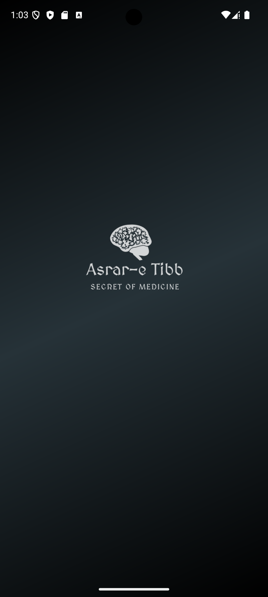
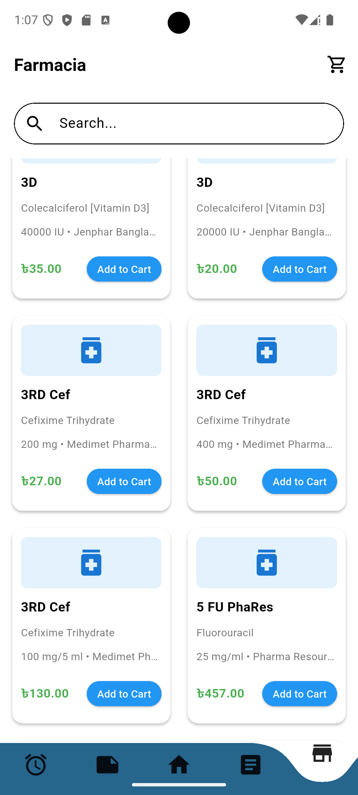
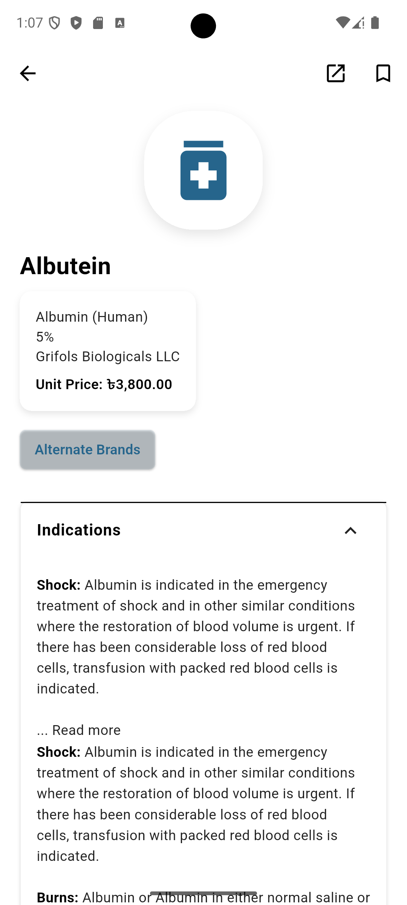
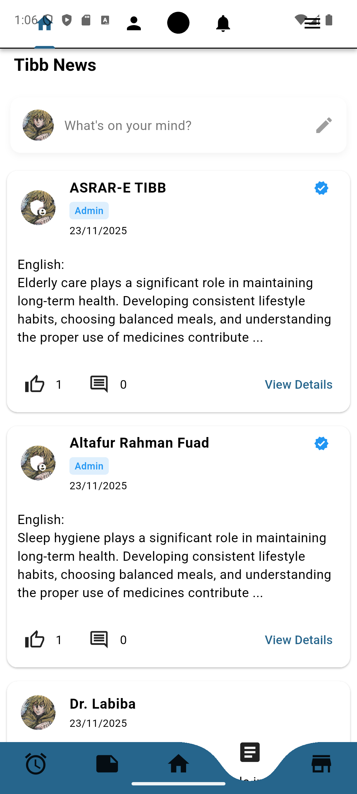
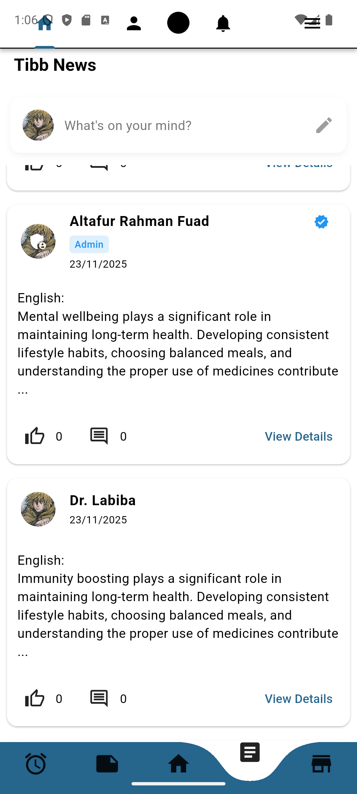

<div align="center">


# 💊 Asrar-e-Tibb (اسرار طب — "Secrets of Medicine")

**A comprehensive healthcare platform: Responsive Web Platform, Flutter Android App, and High-Performance Rust API.**

[](https://flutter.dev)
[](website/)
[](backend/api/)
[](https://supabase.com)
[]()
[]()

### 🌐 Live Platform & Releases
- 🚀 **Web Platform**: [Next.js App Router Website](website/) (Deployable to Vercel)
- 🦀 **Rust API**: [Axum Backend Service](backend/api/) (Deployable to Render via `render.yaml`)
- 📱 **Android APK**: [Download Latest APK & Checksum](https://github.com/altafur-fuad/Asrar-E-Tibb/releases)
- 📚 **Architecture & Implementation**: [`docs/WEB_PLATFORM_IMPLEMENTATION.md`](docs/WEB_PLATFORM_IMPLEMENTATION.md)
- 📊 **Deployment Status & Evidence**: [`docs/DEPLOYMENT_STATUS.md`](docs/DEPLOYMENT_STATUS.md)

</div>

---

## 📖 Overview

**Asrar-e-Tibb** is an integrated healthcare ecosystem combining a **modern responsive web platform**, a **native Android mobile application**, and a **high-performance Rust Axum API**:
1. **Responsive Web Platform (`website/`)**: Complete digital healthcare storefront, clinical medicine directory with 2,900+ curated records, TibbNews editorial feed, honest consultation/OCR preview portals, and direct APK download hub.
2. **Native Android App (`lib/`)**: Flutter app featuring personalized medicine reminders, offline/online medicine lookup, and role-verified community interaction.
3. **Rust API Backend (`backend/api/`)**: Lean microservice providing typed release metadata, safe redirect handling (`GET /api/v1/app/android/download`), and containerized deployment on Render.
4. **Supabase BaaS (`supabase/`)**: PostgreSQL, Auth, Storage, and Realtime with hardened RLS security migrations.

---

## 🖼️ UI / App Design

*(Add your app screenshots inside `docs/screenshots/` folder)*

| Intro / Onboarding | Login | Farmacia (Pharmacy) | Medicine Details |
|:---:|:---:|:---:|:---:|
|  |  |  |  |

| TibbNews Feed | Post Details | Profile | Admin Panel |
|:---:|:---:|:---:|:---:|
|  |  |  |  |

---

## 🎥 Demo Video

```
https://github.com/altafur-fuad/Asrar-E-Tibb/assets/<user-id>/<video-file>.mp4
```

---

## ✨ Key Features

### 🏪 Farmacia (Pharmacy Module)
- Browse a searchable medicine catalog with detailed drug information.
- View **alternative brand** suggestions for any medicine.
- Add-to-cart and full **checkout** flow.
- Structured data model: medicines, generics, drug classes, indications, dosage forms, and manufacturers (loaded from CSV datasets).

### 📰 TibbNews (Health Social Feed)
- Facebook-style feed: create, edit, and delete posts (text + images).
- Like/unlike and threaded comments on every post.
- Verified-user blue-tick badges.
- Dynamic, editable user profiles (bio, profile picture via Supabase Storage).
- Real-time updates for posts, likes, and comments (Supabase Realtime).
- In-app notifications with a notification badge.

### 🛡️ Admin Panel
- Analytics dashboard — total users, posts, blocked users, verified users.
- User management — search, block/unblock, verify accounts.
- Post & comment moderation — admins can remove any content.
- Role-based access control baked into authentication.

### 💊 Personal Health Tools
- Medicine **reminder & notepad** system to schedule doses and take personal notes.

### 🔐 Authentication
- Role-based login/signup (regular user vs. admin) via Supabase Auth.
- Blocked-user checks and session management.

### 🎨 Experience
- Curved bottom navigation bar for smooth screen transitions.
- Light/dark theme controller.
- Lottie animations for micro-interactions.

---

## 🛠️ Tech Stack

| Layer | Technology |
|---|---|
| Framework | Flutter (Dart) |
| Backend / BaaS | Supabase (Postgres, Auth, Storage, Realtime) |
| Local State | Provider |
| Data Import | CSV parsing (`csv`), local JSON/CSV datasets |
| Rich Content | flutter_html, html |
| Media | file_picker, Lottie |
| Navigation | curved_navigation_bar |
| Utilities | uuid, url_launcher, intl |

---

## 📂 Project Structure

```
lib/
├── admin/                    # Admin dashboard, panel, and profile
├── data/                     # Data provider layer
├── farmacia/                 # Pharmacy: cart, checkout, details, listing
├── identity_login_signup/    # Intro, login, signup screens
├── medicine_page/            # Medicine listing, details, alternative brands
├── models/                   # Medicine, Generic, DrugClass, Indication, Manufacturer models
├── pages/                    # Home, About, Contact, Profile, Settings
├── remainder_notepad/        # Medicine reminders & personal notes
├── services/                 # Supabase auth & service helpers
├── tibbnews/                 # Social feed: posts, comments, profiles, notifications
├── app_themes.dart
├── theme_controller.dart
└── main.dart
```

---

## 🚀 Getting Started

```bash
git clone https://github.com/altafur-fuad/Asrar-E-Tibb.git
cd Asrar-E-Tibb
flutter pub get
```

Then follow `SETUP_COMPLETE_GUIDE.md` in the repo to:
1. Create a Supabase project and run the provided SQL schema.
2. Create `post-images` and `profile-pictures` storage buckets.
3. Enable Realtime replication for `posts`, `comments`, `post_likes`, `users`.
4. Create an admin user via SQL.

```bash
flutter run
```

---

## 🗺️ Future Roadmap

- [ ] 💳 Payment gateway integration for Farmacia checkout (bKash/Nagad/card)
- [ ] 📄 E-prescription upload with OCR-based medicine detection
- [ ] 🩺 Doctor / pharmacist consultation booking
- [ ] 📦 Pharmacy inventory & stock management for sellers
- [ ] ⭐ Ratings & reviews for pharmacies and medicines
- [ ] 🔔 Push notifications for orders, likes, and comments
- [ ] 🌍 Multi-language expansion (Bangla-first UI)
- [ ] 📊 Deeper analytics for the admin dashboard (trends, growth charts)

---

## 🤝 Contributing

Issues and PRs are welcome — check the [issues page](https://github.com/altafur-fuad/Asrar-E-Tibb/issues).

## 📄 License

This project is open source. Add your preferred license (MIT recommended) in a `LICENSE` file.

---

<div align="center">Built to make trusted medicine information and health conversation accessible to everyone.</div>