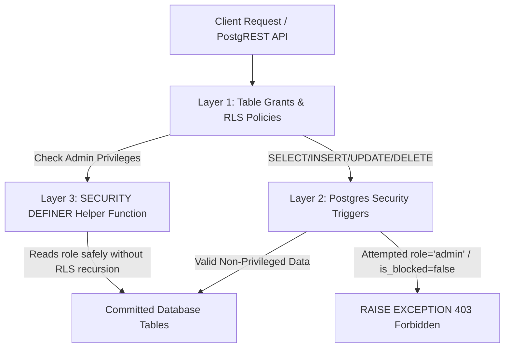

# Asrar-e-Tibb: Supabase Authorization & Database Security Audit

> **Document:** Comprehensive Read-Only Database Security Audit & Privilege-Escalation Remediation Plan
> **Status:** Stage 1 Audit Complete | Stage 2 Code Review Complete | Stage 3B Cloud Staging Active (See [CLOUD_STAGING_RESULTS.md](file:///e:/Asrar-E-Tibb/docs/CLOUD_STAGING_RESULTS.md))
> **Target Database:** Supabase Postgres (`https://ynssqrpfbeavuynxcwxj.supabase.co`)
> **Repository Root:** `e:/Asrar-E-Tibb`
> **Author:** Senior Flutter UI/UX Engineer & Full-Stack Security Auditor
> **Audit Date:** 2026-10-21


---

## 1. Executive Summary

During Milestone 2, client-side route guards, session validation, and local storage spoofing vulnerabilities were addressed in the Flutter mobile application. However, client-side code alone cannot guarantee security against an adversary interacting directly with the Supabase PostgREST API or Supabase Storage endpoints.

This read-only audit investigated the database configuration, schema access patterns, API contracts, and privilege-escalation vectors across all existing Flutter client services and documentation.

### Key Audit Findings:
1. **Critical Privilege-Escalation Vector:** The application architecture relies on direct client writes (`supabase.from("users").upsert(...)`) using the public `anonKey` and authenticated JWT. Without database-level column update restrictions or security triggers on `public.users`, any authenticated user can send an HTTP PATCH request to PostgREST modifying their own `role` to `'admin'` or setting `is_blocked` to `false`.
2. **Missing Local SQL Migration Files:** The repository contains zero `.sql` migration files, zero seed scripts, and zero schema definitions. The active schema exists solely in the remote Supabase cloud project.
3. **Dual Table Identity Schema:** The codebase contains overlapping references to both `public.users` (created during signup) and `public.profiles` (queried during feed loading and profile editing), requiring remediation on both tables.
4. **Client-Filtered Moderation Queries:** Privileged moderation actions (e.g., `adminDeletePost` and `adminDeleteComment` in `supabase_services.dart`) rely on unconditional `DELETE` queries (`DELETE FROM posts WHERE id = :id`). If database RLS policies do not explicitly check administrator claims on the server, either ordinary users can delete arbitrary posts or real administrators will be blocked from deleting others' posts.
5. **Private Data Isolation Risk:** Reminders (`schedules`), notes (`notes`), and to-dos (`todos`) are currently filtered only by client-provided `.eq('user_id', userId)`. If Row Level Security is disabled or broadly permissive on Postgres, any authenticated user can read other users' sensitive medication schedules and health records.

---

## 2. Real Database Schema & Access Pattern Inventory

Based on exhaustive static analysis of all Dart queries (`.from(...)`) in `Asrar-E-Tibb/lib/`:

### 2.1 Identity & Role Tables

#### `public.users`
- **Creation Location:** `lib/identity_login_signup/signuppage.dart:144-154`
- **Write Mechanism:** Direct client `.upsert(...)` using client session.
- **Observed Columns:**
  - `id`: `uuid` (Primary Key, references `auth.users.id`)
  - `name`: `text` (User display name; prefixed with "Dr." for medical doctors)
  - `email`: `text` (User email address)
  - `mobile`: `text` (Phone number)
  - `role`: `text` (`'patient'`, `'doctor'`, `'pharmacist'`, `'shop owner'`, `'admin'`)
  - `dob`: `text` / `date` (ISO-8601 date of birth)
  - `verified`: `boolean` (Self-assigned as `emailVerified` on signup)
  - `is_blocked`: `boolean` (Account suspension flag; initialized as `false` on signup)
  - `created_at`: `timestamptz` (Read in `admin_panel_page.dart:154` for user sorting)
  - `is_admin`: `boolean` (Checked in `admin_panel_page.dart:130` and `supabase_services.dart:451`)
- **Read Locations:**
  - `loginpage.dart:68`: Selects `role, is_blocked` where `id == uid`.
  - `supabase_auth_helper.dart:191`: Selects `id, role, is_blocked, email` where `id == uid`.
  - `admin_panel_page.dart:125, 130, 154`: Selects all user rows and counts admins.

#### `public.profiles`
- **Observed Columns:** `id`, `name`, `email`, `mobile` / `contact`, `blood_group`, `last_donate` / `last_donate_date`, `health_condition`, `home_address`, `office_address`, `dob`, `emergency_contact`, `notes`, `avatar_url` / `profile_picture`, `bio`, `role`, `is_verified`.
- **Write Mechanism:** `lib/services/supabase_services.dart:515` executes `.update(data).eq('id', userId)`.
- **Read Locations:** `supabase_services.dart:272` (merged profile fetch), `reminder_page.dart:40`, `post_details_page.dart:74`.

#### Role-Specific Tables (`patients`, `doctors`, `pharmacists`, `shop_owners`)
- **Creation Location:** `lib/identity_login_signup/signuppage.dart:156`
- **Columns:**
  - `patients`: `user_id`, `auth_id`, `name`, `email`, `mobile`, `gender`, `dob`, `blood_group`.
  - `doctors`: `user_id`, `auth_id`, `name`, `email`, `mobile`, `specialist`, `licence`, `workplace`, `dob`.
  - `pharmacists`: `user_id`, `auth_id`, `name`, `email`, `mobile`, `workplace`, `dob`.
  - `shop_owners`: `user_id`, `auth_id`, `name`, `email`, `mobile`, `shop_name`, `dob`.

---

### 2.2 Community & Moderation Tables

| Table Name | Operations in Code | Observed Columns & Foreign Keys |
|---|---|---|
| `public.posts` | `SELECT`, `INSERT`, `UPDATE`, `DELETE` | `id` (PK), `user_id` (FK to `users.id`), `content` (text), `created_at`, `updated_at`. |
| `public.post_images` | `SELECT`, `INSERT`, `DELETE` | `id` (PK), `post_id` (FK to `posts.id`), `storage_path` (text), `created_at`. |
| `public.post_likes` | `SELECT`, `INSERT`, `DELETE` | `id` (PK), `post_id` (FK to `posts.id`), `user_id` (FK to `users.id`), `created_at`. Unique constraint per `(post_id, user_id)` required. |
| `public.comments` | `SELECT`, `INSERT`, `DELETE` | `id` (PK), `post_id` (FK to `posts.id`), `user_id` (FK to `users.id`), `content` (text), `created_at`. |
| `public.notifications` | `SELECT`, `INSERT` | `id` (PK), `user_id` (recipient FK), `actor_id` (sender FK), `type` ('like', 'comment'), `created_at`. |

---

### 2.3 Personal Health & Private Data Tables

| Table Name | Operations in Code | Observed Columns | Privacy Classification |
|---|---|---|---|
| `public.schedules` | `SELECT`, `INSERT`, `UPDATE`, `DELETE`, `Realtime` | `id`, `user_id`, `medicine_name`, `dosage`, `time`, `created_at` | **Strict Private (Medical Data)** |
| `public.notes` | `SELECT`, `INSERT`, `UPDATE`, `DELETE`, `Realtime` | `id`, `user_id`, `title`, `content`, `pinned`, `created_at` | **Strict Private (Personal Notes)** |
| `public.todos` | `SELECT`, `INSERT`, `UPDATE`, `DELETE`, `Realtime` | `id`, `user_id`, `text`, `done`, `created_at`, `updated_at` | **Strict Private (To-Do Items)** |

---

### 2.4 Supabase Storage Buckets

| Bucket Identifier | Usage in Code | Upload Path Structure | Access Pattern |
|---|---|---|---|
| `post-images` | `SupabaseService.uploadPostImage` | `posts/<uuid>.<ext>` | Public read, authenticated write. |
| `profile-pictures` | `SupabaseService.uploadProfilePicture` | `<userId>/profile.<ext>` | Public read, owner-only write. |

---

## 3. Threat Modeling & Vulnerability Evaluation

| Vulnerability ID | Threat Description | Attack Vector & Technical Mechanism | Severity | Enforcement Point |
|---|---|---|---|---|
| **VULN-DB-01** | **Self-Promotion to Administrator** | Authenticated attacker sends PostgREST `PATCH /rest/v1/users?id=eq.<attacker_id>` with payload `{"role": "admin", "is_admin": true}`. If RLS allows updating own row without column restrictions, the role is updated in Postgres. | **CRITICAL** | Database (Trigger / RLS) |
| **VULN-DB-02** | **Account Suspension Self-Revocation** | A blocked user whose token is still active sends `PATCH /rest/v1/users?id=eq.<user_id>` with `{"is_blocked": false}`. | **HIGH** | Database (Trigger / RLS) |
| **VULN-DB-03** | **Fabrication of Doctor / Verified Badge** | User updates `verified: true` on `users` or `is_verified: true` on `profiles`, impersonating a licensed medical provider on TibbNews. | **HIGH** | Database (Trigger / RLS) |
| **VULN-DB-04** | **Cross-Tenant Health Record Exfiltration** | If RLS is disabled or set to `true` on `schedules`, `notes`, or `todos`, any authenticated user querying `/rest/v1/schedules` receives other patients' medication routines. | **CRITICAL** | Database (RLS) |
| **VULN-DB-05** | **Arbitrary Content Destruction via Admin Query Mimicry** | `SupabaseService.adminDeletePost(postId)` executes `DELETE FROM posts WHERE id = postId`. If the database `DELETE` policy lacks an explicit `is_admin` check and permits deleting any post, any user can delete arbitrary posts. | **HIGH** | Database (RLS) |
| **VULN-DB-06** | **Profile Avatar Overwrite / Path Traversal** | If `profile-pictures` bucket policy allows writing to arbitrary paths, User A can upload to `<user_b_id>/profile.jpg` and overwrite User B's avatar. | **MEDIUM** | Storage RLS Policy |

---

## 4. Remediation Architecture & Design

To resolve these vulnerabilities without disrupting existing Flutter application features or breaking mobile signup, we design a 3-layer defense-in-depth model:



### 4.1 Non-Recursive Admin Helper Function
In PostgreSQL, RLS policies that query the same table to check permissions can trigger infinite recursion. We implement a lightweight, `SECURITY DEFINER` function with pinned `search_path`:

```sql
CREATE OR REPLACE FUNCTION public.is_admin(check_user_id uuid)
RETURNS boolean
LANGUAGE sql
SECURITY DEFINER
SET search_path = public
STABLE
AS $$
  SELECT EXISTS (
    SELECT 1 FROM public.users
    WHERE id = check_user_id
      AND (role = 'admin' OR is_admin IS TRUE)
      AND is_blocked IS NOT TRUE
  );
$$;
```

### 4.2 Privileged Field Protection Trigger (`public.users`)
Rather than breaking the mobile registration flow (which currently writes `name`, `email`, `role`, `mobile`, `dob` in a single `upsert`), a `BEFORE INSERT OR UPDATE` trigger validates every write:

- **On INSERT:**
  - If `NEW.role == 'admin'`, the transaction is aborted with an error.
  - `NEW.is_blocked` is hard-reset to `false`.
  - `NEW.verified` is hard-reset to `false` (or derived strictly from auth verification).
- **On UPDATE:**
  - If `OLD.role != NEW.role`, only callers where `public.is_admin(auth.uid())` is `true` or `auth.jwt() ->> 'role' == 'service_role'` are permitted. Otherwise, an exception is raised.
  - If `OLD.is_blocked != NEW.is_blocked`, only administrators or service-role can modify it.
  - If `OLD.verified != NEW.verified`, only administrators or service-role can modify it.

### 4.3 Mirror Trigger on `public.profiles`
Applies identical field-protection logic to prevent privilege escalation via `updateProfileFull` on `profiles`.

### 4.4 Strict Row Level Security (RLS) Policies

#### `public.users` & `public.profiles`
- `SELECT`: Public or authenticated users can read public profile columns (`id, name, avatar_url, role, verified`). Sensitive fields (`mobile, dob`) restricted to row owner (`auth.uid() = id`) or administrators.
- `INSERT`: Allowed only when `auth.uid() = id`.
- `UPDATE`: Allowed only when `auth.uid() = id` (guarded by the field protection trigger).
- `DELETE`: Restricted to administrators (`public.is_admin(auth.uid())`).

#### `public.schedules`, `public.notes`, `public.todos`
- Enabled RLS with exclusive owner access:
  `USING (auth.uid() = user_id) WITH CHECK (auth.uid() = user_id)`.

#### `public.posts`, `public.post_images`, `public.comments`
- `SELECT`: Permitted for all authenticated users.
- `INSERT`: Permitted with `auth.uid() = user_id`.
- `UPDATE`: Permitted only for the original author: `auth.uid() = user_id`.
- `DELETE`: Permitted for the author **OR** a verified administrator:
  `USING (auth.uid() = user_id OR public.is_admin(auth.uid()))`.

#### `storage.objects`
- `profile-pictures`:
  - `SELECT`: `bucket_id = 'profile-pictures'`.
  - `INSERT` / `UPDATE`: `bucket_id = 'profile-pictures' AND (storage.foldername(name))[1] = auth.uid()::text`.
- `post-images`:
  - `SELECT`: `bucket_id = 'post-images'`.
  - `INSERT`: `bucket_id = 'post-images' AND auth.role() = 'authenticated'`.

---

## 5. Proposed Database Migration Files

The following migration files are prepared for deployment to a local or staging Supabase environment upon explicit approval.

### Migration 1: `backend/migrations/0001_security_functions_and_triggers.sql`

```sql
-- Migration 0001: Admin Helper Function & Privileged Field Protection Triggers
-- Purpose: Prevent authenticated clients from self-promoting to admin or self-unblocking.

-- 1. Helper function to check admin privileges without RLS recursion
CREATE OR REPLACE FUNCTION public.is_admin(check_user_id uuid)
RETURNS boolean
LANGUAGE sql
SECURITY DEFINER
SET search_path = public
STABLE
AS $$
  SELECT EXISTS (
    SELECT 1 FROM public.users
    WHERE id = check_user_id
      AND (role = 'admin' OR is_admin IS TRUE)
      AND is_blocked IS NOT TRUE
  );
$$;

COMMENT ON FUNCTION public.is_admin IS 'Returns true only if the user is a verified, non-blocked administrator.';

-- 2. Trigger function to protect role, is_blocked, and verified on public.users
CREATE OR REPLACE FUNCTION public.protect_user_privileged_fields()
RETURNS trigger
LANGUAGE plpgsql
SECURITY DEFINER
SET search_path = public
AS $$
DECLARE
  caller_is_admin boolean := false;
  caller_is_service_role boolean := false;
BEGIN
  -- Determine caller execution context
  IF auth.uid() IS NOT NULL THEN
    caller_is_admin := public.is_admin(auth.uid());
  END IF;

  IF (current_setting('request.jwt.claims', true)::jsonb ->> 'role') = 'service_role' THEN
    caller_is_service_role := true;
  END IF;

  -- ---------------- ON INSERT (Registration) ----------------
  IF TG_OP = 'INSERT' THEN
    -- Forbid public registration from claiming admin role
    IF LOWER(TRIM(COALESCE(NEW.role, ''))) = 'admin' AND NOT caller_is_service_role THEN
      RAISE EXCEPTION 'Administrative accounts cannot be created via public registration.'
        USING ERRCODE = '42501';
    END IF;

    -- Ensure non-admins cannot initialize themselves as blocked=false override or verified=true
    IF NOT caller_is_service_role THEN
      NEW.is_blocked := false;
      NEW.is_admin := false;
    END IF;
  END IF;

  -- ---------------- ON UPDATE (Profile Edits) ----------------
  IF TG_OP = 'UPDATE' THEN
    -- Check role modification
    IF OLD.role IS DISTINCT FROM NEW.role THEN
      IF NOT (caller_is_admin OR caller_is_service_role) THEN
        RAISE EXCEPTION 'Unauthorized: Modifying user role requires administrator privileges.'
          USING ERRCODE = '42501';
      END IF;
    END IF;

    -- Check is_admin flag modification
    IF OLD.is_admin IS DISTINCT FROM NEW.is_admin THEN
      IF NOT (caller_is_admin OR caller_is_service_role) THEN
        RAISE EXCEPTION 'Unauthorized: Modifying is_admin flag requires administrator privileges.'
          USING ERRCODE = '42501';
      END IF;
    END IF;

    -- Check is_blocked modification
    IF OLD.is_blocked IS DISTINCT FROM NEW.is_blocked THEN
      IF NOT (caller_is_admin OR caller_is_service_role) THEN
        RAISE EXCEPTION 'Unauthorized: Modifying account suspension status requires administrator privileges.'
          USING ERRCODE = '42501';
      END IF;
    END IF;

    -- Check verified status modification
    IF OLD.verified IS DISTINCT FROM NEW.verified THEN
      IF NOT (caller_is_admin OR caller_is_service_role) THEN
        RAISE EXCEPTION 'Unauthorized: Modifying professional verification requires administrator privileges.'
          USING ERRCODE = '42501';
      END IF;
    END IF;
  END IF;

  RETURN NEW;
END;
$$;

DROP TRIGGER IF EXISTS trg_protect_user_privileged_fields ON public.users;
CREATE TRIGGER trg_protect_user_privileged_fields
BEFORE INSERT OR UPDATE ON public.users
FOR EACH ROW EXECUTE FUNCTION public.protect_user_privileged_fields();

-- 3. Mirror trigger on public.profiles if table exists
DO $$
BEGIN
  IF EXISTS (SELECT 1 FROM information_schema.tables WHERE table_schema = 'public' AND table_name = 'profiles') THEN
    EXECUTE '
      DROP TRIGGER IF EXISTS trg_protect_profiles_privileged_fields ON public.profiles;
      CREATE TRIGGER trg_protect_profiles_privileged_fields
      BEFORE INSERT OR UPDATE ON public.profiles
      FOR EACH ROW EXECUTE FUNCTION public.protect_user_privileged_fields();
    ';
  END IF;
END $$;
```

---

### Migration 2: `backend/migrations/0002_rls_policies.sql`

```sql
-- Migration 0002: Row Level Security Policies for Core & Personal Data
-- Purpose: Enforce strict owner isolation on private health data and permit admin moderation.

-- 1. Personal Health Data (Owner Isolation)
ALTER TABLE IF EXISTS public.schedules ENABLE ROW LEVEL SECURITY;
ALTER TABLE IF EXISTS public.notes ENABLE ROW LEVEL SECURITY;
ALTER TABLE IF EXISTS public.todos ENABLE ROW LEVEL SECURITY;

DROP POLICY IF EXISTS "schedules_owner_policy" ON public.schedules;
CREATE POLICY "schedules_owner_policy" ON public.schedules
  FOR ALL TO authenticated
  USING (auth.uid() = user_id)
  WITH CHECK (auth.uid() = user_id);

DROP POLICY IF EXISTS "notes_owner_policy" ON public.notes;
CREATE POLICY "notes_owner_policy" ON public.notes
  FOR ALL TO authenticated
  USING (auth.uid() = user_id)
  WITH CHECK (auth.uid() = user_id);

DROP POLICY IF EXISTS "todos_owner_policy" ON public.todos;
CREATE POLICY "todos_owner_policy" ON public.todos
  FOR ALL TO authenticated
  USING (auth.uid() = user_id)
  WITH CHECK (auth.uid() = user_id);

-- 2. Community Posts & Moderation
ALTER TABLE IF EXISTS public.posts ENABLE ROW LEVEL SECURITY;
ALTER TABLE IF EXISTS public.comments ENABLE ROW LEVEL SECURITY;
ALTER TABLE IF EXISTS public.post_likes ENABLE ROW LEVEL SECURITY;
ALTER TABLE IF EXISTS public.post_images ENABLE ROW LEVEL SECURITY;
ALTER TABLE IF EXISTS public.notifications ENABLE ROW LEVEL SECURITY;

-- Posts: Public Read, Author Create/Edit, Author OR Admin Delete
DROP POLICY IF EXISTS "posts_select_policy" ON public.posts;
CREATE POLICY "posts_select_policy" ON public.posts
  FOR SELECT TO authenticated
  USING (true);

DROP POLICY IF EXISTS "posts_insert_policy" ON public.posts;
CREATE POLICY "posts_insert_policy" ON public.posts
  FOR INSERT TO authenticated
  WITH CHECK (auth.uid() = user_id);

DROP POLICY IF EXISTS "posts_update_policy" ON public.posts;
CREATE POLICY "posts_update_policy" ON public.posts
  FOR UPDATE TO authenticated
  USING (auth.uid() = user_id)
  WITH CHECK (auth.uid() = user_id);

DROP POLICY IF EXISTS "posts_delete_policy" ON public.posts;
CREATE POLICY "posts_delete_policy" ON public.posts
  FOR DELETE TO authenticated
  USING (auth.uid() = user_id OR public.is_admin(auth.uid()));

-- Comments: Public Read, Author Create, Author OR Admin Delete
DROP POLICY IF EXISTS "comments_select_policy" ON public.comments;
CREATE POLICY "comments_select_policy" ON public.comments
  FOR SELECT TO authenticated
  USING (true);

DROP POLICY IF EXISTS "comments_insert_policy" ON public.comments;
CREATE POLICY "comments_insert_policy" ON public.comments
  FOR INSERT TO authenticated
  WITH CHECK (auth.uid() = user_id);

DROP POLICY IF EXISTS "comments_delete_policy" ON public.comments;
CREATE POLICY "comments_delete_policy" ON public.comments
  FOR DELETE TO authenticated
  USING (auth.uid() = user_id OR public.is_admin(auth.uid()));

-- Post Likes: Read All, Insert Own, Delete Own
DROP POLICY IF EXISTS "likes_select_policy" ON public.post_likes;
CREATE POLICY "likes_select_policy" ON public.post_likes
  FOR SELECT TO authenticated
  USING (true);

DROP POLICY IF EXISTS "likes_insert_policy" ON public.post_likes;
CREATE POLICY "likes_insert_policy" ON public.post_likes
  FOR INSERT TO authenticated
  WITH CHECK (auth.uid() = user_id);

DROP POLICY IF EXISTS "likes_delete_policy" ON public.post_likes;
CREATE POLICY "likes_delete_policy" ON public.post_likes
  FOR DELETE TO authenticated
  USING (auth.uid() = user_id);

-- Post Images: Read All, Insert Authenticated, Delete Author OR Admin
DROP POLICY IF EXISTS "post_images_select_policy" ON public.post_images;
CREATE POLICY "post_images_select_policy" ON public.post_images
  FOR SELECT TO authenticated
  USING (true);

DROP POLICY IF EXISTS "post_images_insert_policy" ON public.post_images;
CREATE POLICY "post_images_insert_policy" ON public.post_images
  FOR INSERT TO authenticated
  WITH CHECK (true);

DROP POLICY IF EXISTS "post_images_delete_policy" ON public.post_images;
CREATE POLICY "post_images_delete_policy" ON public.post_images
  FOR DELETE TO authenticated
  USING (
    EXISTS (
      SELECT 1 FROM public.posts
      WHERE posts.id = post_images.post_id
        AND (posts.user_id = auth.uid() OR public.is_admin(auth.uid()))
    )
  );

-- Notifications: Read Own, Insert Authenticated Actor
DROP POLICY IF EXISTS "notifications_select_policy" ON public.notifications;
CREATE POLICY "notifications_select_policy" ON public.notifications
  FOR SELECT TO authenticated
  USING (auth.uid() = user_id);

DROP POLICY IF EXISTS "notifications_insert_policy" ON public.notifications;
CREATE POLICY "notifications_insert_policy" ON public.notifications
  FOR INSERT TO authenticated
  WITH CHECK (auth.uid() = actor_id);
```

---

### Migration 3: `backend/migrations/0003_storage_policies.sql`

```sql
-- Migration 0003: Storage Bucket Access Policies
-- Purpose: Restrict profile picture uploads to user-owned folders and allow public asset reads.

-- Profile Pictures Bucket
DROP POLICY IF EXISTS "profile_pictures_select" ON storage.objects;
CREATE POLICY "profile_pictures_select" ON storage.objects
  FOR SELECT TO public
  USING (bucket_id = 'profile-pictures');

DROP POLICY IF EXISTS "profile_pictures_insert" ON storage.objects;
CREATE POLICY "profile_pictures_insert" ON storage.objects
  FOR INSERT TO authenticated
  WITH CHECK (
    bucket_id = 'profile-pictures' AND
    (storage.foldername(name))[1] = auth.uid()::text
  );

DROP POLICY IF EXISTS "profile_pictures_update" ON storage.objects;
CREATE POLICY "profile_pictures_update" ON storage.objects
  FOR UPDATE TO authenticated
  USING (
    bucket_id = 'profile-pictures' AND
    (storage.foldername(name))[1] = auth.uid()::text
  );

-- Post Images Bucket
DROP POLICY IF EXISTS "post_images_select" ON storage.objects;
CREATE POLICY "post_images_select" ON storage.objects
  FOR SELECT TO public
  USING (bucket_id = 'post-images');

DROP POLICY IF EXISTS "post_images_insert" ON storage.objects;
CREATE POLICY "post_images_insert" ON storage.objects
  FOR INSERT TO authenticated
  WITH CHECK (
    bucket_id = 'post-images' AND
    auth.role() = 'authenticated'
  );
```

---

## 6. Staging Security Test Matrix & Verification Protocol

The following automated or curl-based verification matrix is to be executed in a safe staging or local Supabase environment prior to production migration:

| Test ID | Test Scenario | Execution Command / Direct API Request | Expected Status & Result |
|---|---|---|---|
| **SEC-01** | **Unauthenticated Data Access** | `GET /rest/v1/schedules` without `Authorization` header | **401 Unauthorized** (Zero rows returned). |
| **SEC-02** | **Self-Promotion to Admin** | `PATCH /rest/v1/users?id=eq.<user_a_id>` with payload `{"role": "admin"}` and User A JWT | **403 Forbidden** / Error `42501` raised by trigger. Role remains `'patient'`. |
| **SEC-03** | **Self-Unblocking Attempt** | `PATCH /rest/v1/users?id=eq.<user_a_id>` with payload `{"is_blocked": false}` when suspended | **403 Forbidden** / Error `42501`. `is_blocked` remains `true`. |
| **SEC-04** | **Cross-User Data Access** | User A queries `GET /rest/v1/notes?user_id=eq.<user_b_id>` with User A JWT | **200 OK with empty array `[]`** (RLS filters out User B's rows). |
| **SEC-05** | **Cross-User Data Modification** | User A sends `DELETE /rest/v1/notes?id=eq.<user_b_note_id>` with User A JWT | **200 OK with 0 affected rows**. User B's note remains untouched. |
| **SEC-06** | **Unauthorized Moderation Delete** | Non-admin User A sends `DELETE /rest/v1/posts?id=eq.<user_b_post_id>` | **200 OK with 0 affected rows**. User B's post is preserved. |
| **SEC-07** | **Authorized Admin Moderation** | Verified Admin sends `DELETE /rest/v1/posts?id=eq.<user_b_post_id>` | **200 OK with 1 affected row**. Post is successfully deleted. |
| **SEC-08** | **Registration with Forged Role** | Public client sends `POST /rest/v1/users` with `{"id": "<new_uid>", "role": "admin"}` | **403 Forbidden** / Error `42501`. Registration fails or role defaults to non-admin. |
| **SEC-09** | **Cross-User Storage Overwrite** | User A attempts `POST /storage/v1/object/profile-pictures/<user_b_id>/profile.jpg` | **403 Forbidden** (Policy denies writing to folder path not matching `auth.uid()`). |

---

## 7. Open Questions Requiring Owner Decision

Before applying migrations to the staging or production Supabase database:

1. **Initial Administrator Provisioning:**
   Since public registration will strictly reject `role = 'admin'`, how should the primary production administrator account (`asraretibb@gmail.com` or designated UUID) be designated?
   *Recommendation:* Execute a one-time manual SQL statement in the Supabase Dashboard SQL Editor using database superuser credentials:
   ```sql
   UPDATE public.users SET role = 'admin', is_admin = true WHERE email = 'asraretibb@gmail.com';
   ```
2. **`users` vs `profiles` Table Consolidation:**
   The codebase currently queries both `users` and `profiles`. Should a future milestone consolidate these into a unified `public.profiles` table linked via foreign key to `auth.users`, or keep the current dual-table structure?
   *Recommendation:* Preserve both tables with identical security triggers in the near term to prevent breaking existing profile edit pages, with consolidation planned for Milestone 8 (Profile & Settings).

---

## 8. Summary & Next Steps

- **Read-Only Audit Status:** Complete.
- **Stage 2 Migration Code Review:** Complete. See [`docs/SECURITY_MIGRATION_REVIEW.md`](file:///e:/Asrar-E-Tibb/docs/SECURITY_MIGRATION_REVIEW.md) for full vulnerability corrections, authoritative context architecture, and staging setup plan.
- **Migration Code Prepared:** Corrected versions ready in `backend/migrations/` (un-executed).
- **Current State:** Zero production changes made. Milestone 3 remains paused pending owner review and explicit approval of this security plan.
- **Stage 3B Cloud Staging Verification:** Active on `zhhreesobwvhzmwshaqh`. All 14 tables, probe-resistant RPC `is_admin`, and storage buckets verified. Initial automated tests STG-01, STG-04, and STG-10 verified passing. See [`docs/CLOUD_STAGING_RESULTS.md`](file:///e:/Asrar-E-Tibb/docs/CLOUD_STAGING_RESULTS.md) for full execution details.


