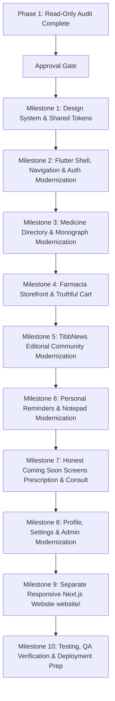

# Asrar-e-Tibb: UI/UX & Technical Architecture Audit

> **Document:** Comprehensive Read-Only Audit & Modernization Roadmap
> **Status:** Stage 0, 1, 2 Complete | Stage 3B Cloud Staging Active (See [CLOUD_STAGING_RESULTS.md](file:///e:/Asrar-E-Tibb/docs/CLOUD_STAGING_RESULTS.md))
> **Repository Root:** `e:/Asrar-E-Tibb`
> **Flutter App Root:** `e:/Asrar-E-Tibb/Asrar-E-Tibb`
> **Target Website Directory:** `e:/Asrar-E-Tibb/website`
> **Target Backend Directory:** `e:/Asrar-E-Tibb/backend`
> **Author:** Senior Flutter UI/UX Engineer & Full-Stack Developer
> **Audit Date:** 2026-10-21

---

## 1. Executive Summary & Verification Methodology

A thorough, read-only inspection of the Asrar-e-Tibb repository was conducted across all files, configurations, dependencies, assets, medicine datasets, services, authentication flows, and tests. No code modifications, database schema edits, or file renames were performed during this audit.

### Key Audit Conclusions:
1. **Repository Structure:** The repository has a nested structure where the root directory (`e:/Asrar-E-Tibb`) contains documentation (`docs/`), reference images (`docs/reference_images/`), `.env.example`, `website/` (un-scaffolded, containing only `README.md`), `backend/` (un-scaffolded, containing only `README.md`), and an inner directory (`e:/Asrar-E-Tibb/Asrar-E-Tibb`) which contains the actual Git repository (`.git`), Flutter app (`pubspec.yaml`, `lib/`, `assets/`, `test/`, and platform folders `android/`, `ios/`, `web/`, `linux/`, `macos/`, `windows/`).
2. **Current Visual Identity vs Target Brand:** The Flutter app currently uses an ad-hoc blue theme (`AppThemes.primaryBlue = Color(0xFF26658C)`) with mixed hardcoded hex colors (`#0C4B63`, `#1C3B50`, `Colors.blueAccent`). This conflicts with the required forest-green (`#064E3B`), fresh-green (`#23845B`), and warm-ivory (`#F7F7F2`) brand tokens established in `docs/2. DESIGN.md` and `docs/UI_MODERNIZATION_README.md`.
3. **Severe Architectural & Crash Vulnerabilities:**
   - In `lib/pages/homepage.dart`, `HomePageInternal` constructs `_HomePageState()._buildHomePage(context)` directly, instantiating an unmounted State object without a StatefulWidget lifecycle, creating state disconnection and animation instability.
   - In `lib/pages/profilepage.dart`, `client.auth.currentUser!.id` performs an unchecked force unwrap, causing an immediate crash if a user navigates to the profile when unauthenticated. Furthermore, it contains a hardcoded Linux filesystem path `static const String coverImagePath = '/mnt/data/4264a975-7848-499c-89c1-49136a30ead5.jpg';`.
   - In `lib/identity_login_signup/intropage.dart`, admin access checks rely on `SharedPreferences.getString('user_role') == 'admin'`, allowing client-side elevation if local storage is modified or spoofed.
4. **Data & Image Realities:**
   - Neither `assets/data/medicine.csv` (21,715 rows) nor `assets/data/generic.csv` (19,566 rows) contains image URLs or image mapping columns.
   - There are **zero individual medicine product photos** in `assets/image/`.
   - In `lib/farmacia/details_page.dart`, the app is displaying `assets/image/pic.png` (a developer personal portrait) as the medicine product image! This violates core product standards.
5. **Inert Controls & Mock Workflows:**
   - `lib/farmacia/checkoutpage.dart` has hardcoded addresses ("Home: Muradpur", "Office: Muradpur") and pops a mock `AlertDialog("Order Placed!")` on click without inserting any order record into Supabase or calling any backend.
   - `lib/pages/setting.dart` has switches that do not alter the app theme, inert buttons for language and privacy, and a logout button that contains only `// TODO: Add your logout logic`.
   - `lib/pages/contact_us.dart` contains raw dummy text: `"Your Name Here"`, `"yourmail@gmail.com"`, `"+8801XXXXXXXXX"`.
   - There are **no Prescription upload/OCR** screens and **no Doctor/Pharmacist consultation** screens anywhere in the codebase.
6. **Baseline Quality Checks:**
   - `flutter analyze` passed with 0 compilation errors and 26 info/warnings (all 26 are deprecations for `withOpacity` vs `.withValues()`).
   - `flutter test` failed immediately because `test/widget_test.dart` is the default counter template test which crashes on missing Provider and missing text `'0'`.

---

## 2. Actual Project Tree & Directory Map

```text
e:/Asrar-E-Tibb/
├── .env.example
├── ANTIGRAVITY_MASTER_PROMPT.md
├── README.md
├── backend/
│   └── README.md                       [Target for Rust Axum service]
├── website/
│   └── README.md                       [Target for separate Next.js web application]
├── docs/
│   ├── 1. PRD.md
│   ├── 2. DESIGN.md
│   ├── 3. ARCHITECTURE.md
│   ├── 4. DATABASE.md
│   ├── 5. API.md
│   ├── 6. AGENTS.md
│   ├── 7. Readme.md
│   ├── 8. Project Implementation.md
│   ├── 9. Setup.md
│   ├── 10. Feature Development.md
│   ├── 11. Authentication & Security.md
│   ├── 12. MCP Connection.md
│   ├── 13. Integrations.md
│   ├── 14. Testing & QA.md
│   ├── 15. Debugging.md
│   ├── DEPLOYMENT.md
│   ├── ENVIRONMENT.md
│   ├── INITIAL_AUDIT.md
│   ├── REFERENCE_ASSETS.md
│   ├── REFERENCE_IMAGE_MANIFEST.md
│   ├── UI_MODERNIZATION_README.md
│   └── reference_images/               [9 layout/composition reference screenshots]
└── Asrar-E-Tibb/                       [Actual Flutter Mobile Application & Git Repository]
    ├── .git/
    ├── .gitignore
    ├── .metadata
    ├── README.md
    ├── SETUP_COMPLETE_GUIDE.md
    ├── analysis_options.yaml
    ├── pubspec.yaml                    [SDK: ^3.9.0; Flutter 3.35.2]
    ├── pubspec.lock
    ├── android/
    ├── ios/
    ├── web/                            [Flutter platform web host - DO NOT OVERWRITE]
    ├── linux/
    ├── macos/
    ├── windows/
    ├── test/
    │   └── widget_test.dart            [Default template test - Currently FAILING]
    ├── assets/
    │   ├── data/
    │   │   ├── dosage_form.csv         [114 rows, 4.89 KB]
    │   │   ├── drug_class.csv          [454 rows, 30.88 KB]
    │   │   ├── generic.csv             [19,566 rows, 8,319.77 KB]
    │   │   ├── indication.csv          [2,044 rows, 121.59 KB]
    │   │   ├── manufacturer.csv        [241 rows, 14.19 KB]
    │   │   └── medicine.csv            [21,715 rows, 3,753.73 KB]
    │   ├── icon/
    │   │   └── app_icon.png            [3.61 MB]
    │   └── image/
    │       ├── banner1.png, banner2.png, banner3.png, banner4.jpg
    │       ├── heart.json, heart.png
    │       ├── logo.png, logo2.png, logo_dark1.png, logo_dark2.png, logo_light1.png, logo_light2.png, ll.png
    │       ├── medicine.png            [Generic medicine icon, 19.18 KB]
    │       └── pic.png                 [Developer headshot portrait, 1,002.92 KB]
    └── lib/
        ├── main.dart                   [Entry point, Supabase init, MultiProvider, MaterialApp]
        ├── app_themes.dart             [PrimaryBlue ThemeData, Light and Dark]
        ├── theme_controller.dart       [ThemeController ChangeNotifier with SharedPreferences]
        ├── admin/
        │   ├── admin_panel_page.dart   [Analytics, Users, Posts, Comments moderation tabs]
        │   ├── adminhomepage.dart      [Admin dashboard variant of HomePage]
        │   └── adminprofile.dart       [Admin profile screen]
        ├── data/
        │   └── data_provider.dart      [In-memory CSV caches and filter methods]
        ├── farmacia/
        │   ├── cart_page.dart          [Cart items list, quantity counters, checkout CTA]
        │   ├── cart_provider.dart      [CartProvider ChangeNotifier with in-memory CartItem list]
        │   ├── checkoutpage.dart       [Mock delivery address, payment method, mock dialog]
        │   ├── details_page.dart       [Medicine detail with hardcoded pic.png and Add to Cart]
        │   └── farmacia_page.dart      [Product grid with Icons.medication and search filter]
        ├── identity_login_signup/
        │   ├── identityscreen.dart     [Role selection: Patient, Doctor, Pharmacist, Shop Owner]
        │   ├── intropage.dart          [Launch animation, session check, admin route bypass]
        │   ├── loginpage.dart          [Email/password login, role match, block check]
        │   └── signuppage.dart         [Registration form with role-specific tables]
        ├── medicine_page/
        │   ├── alternative_brands_page.dart [Find other brands with same generic name]
        │   ├── listpage.dart           [Category browsing: Generic, Indication, etc.]
        │   ├── medicine_list_page.dart [Alphabetical medicine list with search]
        │   └── medicinedetailspage.dart[Detailed medicine view, HTML monograph, alternate brands]
        ├── models/
        │   ├── dosage_form_model.dart
        │   ├── drug_class_model.dart
        │   ├── generic_model.dart
        │   ├── indication_model.dart
        │   ├── manufacturer_model.dart
        │   └── medicine_model.dart     [Parses medicine.csv, dynamic price regex from package size]
        ├── pages/
        │   ├── about_page.dart         [App info card with "AsrareTibb / Medilens"]
        │   ├── contact_us.dart         [Developer placeholder contact card with pic.png]
        │   ├── homepage.dart           [Main navigation shell, carousel, category grid]
        │   ├── profile_settings_page.dart [Profile edit form, Supabase Storage avatar upload, logout]
        │   ├── profilepage.dart        [User profile view, posts, crashing on null user, hardcoded Linux path]
        │   └── setting.dart            [Inert settings list, disconnected toggles, TODO logout]
        ├── remainder_notepad/
        │   ├── create_schedule_page.dart [Schedule form: medicine name, dose, time of day]
        │   ├── note_editor_page.dart   [Note title and content editor]
        │   ├── notepad_page.dart       [Notes and To-Do lists with Supabase streams]
        │   └── reminder_page.dart      [Medication reminder timeline, calendar bar, schedules stream]
        ├── services/
        │   ├── supabase_auth_helper.dart [SupabaseAuthService auth wrapper]
        │   └── supabase_services.dart  [SupabaseService CRUD and Realtime streams]
        └── tibbnews/
            ├── comments_sheet.dart     [Comments bottom sheet with add and delete]
            ├── create_post_page.dart   [Create post with text and image upload]
            ├── edit_post_page.dart     [Edit post content and image]
            ├── edit_profile_page.dart  [Edit name, bio, and avatar]
            ├── menue_page.dart         [TibbNews quick links]
            ├── news_feed_page.dart     [Posts stream feed with PostCard list]
            ├── notification_page.dart  [Notifications list]
            ├── notificationbadge.dart  [Unread notification counter badge]
            ├── post_card.dart          [Post author, text, images, likes, comments, delete]
            ├── post_details_page.dart  [Post full view with embedded comments]
            ├── profile_page.dart       [Profile wrapper]
            ├── tibbnewspage.dart       [TibbNews shell with NestedScrollView and TabBar]
            └── user_profile_page.dart  [Public user profile and user's posts]
```

---

## 3. Git Status & Repository Verification

- **Repository Status:** Clean on branch `main` (`origin/main`).
- **Recent Git Commits:**
  - `b61b44e`: `readme file updated`
  - `2b61804`: `change little`
  - `dc0fe90`: `Initial commit`
  - `dfc1ebf`: `first commit`
- **Working Tree Integrity:** All original files remain intact and unmodified. Generated platform build registration files (`windows/`, `linux/`, `macos/`) were generated by `flutter pub get`.

---

## 4. Baseline Tool Checks & Verified Results

| Tool / Command | Directory | Exit Code | Observed Output / Diagnostics |
|---|---|---|---|
| `flutter --version` | `e:/Asrar-E-Tibb/Asrar-E-Tibb` | `0` | Flutter 3.35.2 • Dart 3.9.0 • DevTools 2.48.0 |
| `flutter pub get` | `e:/Asrar-E-Tibb/Asrar-E-Tibb` | `0` (resolved) | Dependencies resolved and packages downloaded (`Got dependencies!`). 65 packages have newer versions. Windows symlink note logged. |
| `flutter analyze` | `e:/Asrar-E-Tibb/Asrar-E-Tibb` | `1` (info/warning) | **26 issues found** — all 26 are deprecation warnings for `withOpacity` vs `.withValues()`. **Zero syntax or compilation errors**. |
| `flutter test` | `e:/Asrar-E-Tibb/Asrar-E-Tibb` | `1` (failed) | **1 failed test** (`Counter increments smoke test` in `test/widget_test.dart`). Crashed with `ProviderNotFoundException` for `ThemeController` and failed counter expectation. No production unit or widget tests exist. |
| `node -v` & `npm -v` | `e:/Asrar-E-Tibb` | `0` | Node `v24.21.0`, npm `11.19.0` ready for Next.js website implementation. |

---

## 5. Comprehensive Screen & Feature Inventory

### 5.1 App Shell, Onboarding & Authentication

| Screen | File Path | Status | Verification Observations & Defects |
|---|---|---|---|
| **Intro / Splash** | `lib/identity_login_signup/intropage.dart` | Partially Working | 3-second delay animation. **Security flaw:** routes directly to `AdminHomePage()` if local `SharedPreferences` contains `user_role == 'admin'`, completely bypassing server session verification. |
| **Role Selection** | `lib/identity_login_signup/identityscreen.dart` | Working | Lets user select Patient, Doctor, Pharmacist, or Shop Owner. Writes selected role to `SharedPreferences` and navigates to Login or Signup. |
| **Login** | `lib/identity_login_signup/loginpage.dart` | Working | Supabase email/password login. Checks `users` table for matching `role` and `is_blocked`. Routes to `AdminHomePage` if role is `admin`, otherwise `HomePage`. |
| **Sign Up** | `lib/identity_login_signup/signuppage.dart` | Working | Signs up via Supabase Auth. Direct client write into `users` table (`role`, `verified`, `is_blocked`) and role tables (`patients`, `doctors`, `pharmacists`, `shop_owners`). Blocks manual admin creation. |

### 5.2 Home Shell & Navigation

| Screen | File Path | Status | Verification Observations & Defects |
|---|---|---|---|
| **Home Navigation Shell** | `lib/pages/homepage.dart` | Working with Architecture Defect | Uses `CurvedNavigationBar` (5 tabs: Reminder, Notepad, Home, TibbNews, Farmacia). **Architectural defect:** `HomePageInternal` invokes `_HomePageState()._buildHomePage(context)` creating an unmounted State object. Carousel has 4 banners on a 2-second loop. |
| **Category Grid** | `lib/pages/homepage.dart` | Working | Grid tiles for Generic, Indication, Brand Name, Dosage Form, Manufacturer, Drug Class, Contact Us, About, Settings. Generic/brand navigation works. |
| **Greeting Copy** | `lib/pages/homepage.dart` | Unprofessional Copy | Hardcoded string `userRole == 'admin' ? "Hello Admin 😎" : "Hello  broo"`. Needs replacement with professional, calm Islamic/universal greeting. |

### 5.3 Medicine Directory & Search

| Screen | File Path | Status | Verification Observations & Defects |
|---|---|---|---|
| **Category List** | `lib/medicine_page/listpage.dart` | Working | Dynamically loads and filters Generics (19,566), Indications (2,044), Manufacturers (241), Drug Classes (454), Dosage Forms (114). Clean search filter. |
| **Medicine List** | `lib/medicine_page/medicine_list_page.dart` | Working | Filters `medicine.csv` (21,715 items) by category or generic. Alphabetical sorting. Search by brand, generic, or manufacturer. |
| **Medicine Details** | `lib/medicine_page/medicinedetailspage.dart` | Working | Displays brand name, generic, strength, manufacturer, unit price parsed from container size, and expandable HTML monograph sections. Lacks genuine medicine photo (uses `Icons.medication`). Contains small disclaimer note at bottom. |
| **Alternative Brands** | `lib/medicine_page/alternative_brands_page.dart` | Working | Queries `medicine.csv` for other brands sharing the identical generic name. Works reliably. |

### 5.4 TibbNews Community Feed

| Screen | File Path | Status | Verification Observations & Defects |
|---|---|---|---|
| **TibbNews Shell** | `lib/tibbnews/tibbnewspage.dart` | Working | NestedScrollView with sliding animated TabBar (Feed, Profile, Notifications, Menu). |
| **News Feed** | `lib/tibbnews/news_feed_page.dart` | Working | "What's on your mind?" shortcut card. Realtime StreamBuilder from `posts` table. Renders list of `PostCard`. |
| **Post Card** | `lib/tibbnews/post_card.dart` | Working | Displays author avatar, blue verified badge, content, post images, like count toggle, comment count, share, delete (owner or admin). |
| **Post Details & Comments** | `lib/tibbnews/post_details_page.dart` & `comments_sheet.dart` | Working | Detailed view with embedded comments stream, add comment, delete comment. |
| **Create & Edit Post** | `lib/tibbnews/create_post_page.dart` & `edit_post_page.dart` | Working | Text content + image picker uploading to Supabase Storage bucket `post-images`. |
| **User Profile (TibbNews)** | `lib/tibbnews/user_profile_page.dart` | Working | Displays user details and their specific published posts. |
| **Notifications** | `lib/tibbnews/notification_page.dart` | Working | List of notifications from `notifications` table. |

### 5.5 Farmacia / E-Commerce

| Screen | File Path | Status | Verification Observations & Defects |
|---|---|---|---|
| **Farmacia Storefront** | `lib/farmacia/farmacia_page.dart` | Working Catalog | Product grid of medicines with search. Displays `Icons.medication` in blue container, brand name, generic, manufacturer, price. "Add to Cart" button. |
| **Product Details** | `lib/farmacia/details_page.dart` | **Defective Image** | Shows brand name, generic, manufacturer, dosage. **Critical bug:** displays `Image.asset('assets/image/pic.png')` (developer portrait photo) as the product photo. |
| **Shopping Cart** | `lib/farmacia/cart_page.dart` | Working In-Memory | List of cart items with quantity increment/decrement/delete, subtotal calculation, checkout CTA. State lives in memory (`CartProvider`), not persisted to local storage or DB. |
| **Checkout** | `lib/farmacia/checkoutpage.dart` | **Fake / Mock Flow** | Hardcoded delivery addresses ("Home: Muradpur", "Office: Muradpur"), mock payment selection (Cash, Mobile, Card). **Critical:** "Confirm & Pay" button triggers a client-only `AlertDialog("Order Placed!")` without creating any order row or charging payment. |

### 5.6 Personal Health Tools (Reminders & Notes)

| Screen | File Path | Status | Verification Observations & Defects |
|---|---|---|---|
| **Medication Reminder** | `lib/remainder_notepad/reminder_page.dart` | Working | Calendar day selector, medication reminder timeline, FAB to add schedule. Stream filtered by `user_id` from Supabase `schedules` table. Private to authenticated user. Hardcoded color `#0C4B63`. |
| **Create Schedule** | `lib/remainder_notepad/create_schedule_page.dart` | Working | Form for medicine name, dose, and time of day picker. Inserts into `schedules` table. |
| **Notepad & Tasks** | `lib/remainder_notepad/notepad_page.dart` | Working | Tabs for Notes and To-Do list. Private to `user_id`. Supabase Realtime streams for `notes` and `todos` tables. |
| **Note Editor** | `lib/remainder_notepad/note_editor_page.dart` | Working | Title and content editor. Clean and functional. |

### 5.7 Profiles, Settings & Admin Panel

| Screen | File Path | Status | Verification Observations & Defects |
|---|---|---|---|
| **User Profile Page** | `lib/pages/profilepage.dart` | **Crash Risk & Broken Path** | Profile stats, user bio, personal information, user posts. **Critical crashes:** 1) `client.auth.currentUser!.id` force unwrap crashes if logged out; 2) `coverImagePath = '/mnt/data/4264a975-7848-499c-89c1-49136a30ead5.jpg'` is an invalid Linux path. |
| **Profile Settings** | `lib/pages/profile_settings_page.dart` | Working | Edits profile fields, uploads avatar to `profile-pictures` bucket, working logout with confirmation and session clear. |
| **App Settings** | `lib/pages/setting.dart` | **Inert / Dummy Controls** | Dark Mode toggle does not connect to `ThemeController`. Notification toggle does nothing. Language, Privacy, App Info are inert. Logout has `// TODO: Add your logout logic`. |
| **About Page** | `lib/pages/about_page.dart` | Static | Displays "AsrareTibb / Medilens", mission, version v1.0.0. Basic card layout. |
| **Contact Us** | `lib/pages/contact_us.dart` | **Unprofessional Placeholders** | Displays developer photo (`pic.png`), `"Your Name Here"`, `"yourmail@gmail.com"`, `"+8801XXXXXXXXX"`. |
| **Admin Home & Panel** | `lib/admin/adminhomepage.dart` & `admin_panel_page.dart` | Working Admin Tool | Analytics tab (total users, posts, comments, likes, admins), Users tab (search users), Posts tab (moderate/delete any post), Comments tab (moderate/delete any comment). Realtime subscriptions to 6 tables. |

### 5.8 Missing Features (Required by Master Brief)

| Feature | Current State | Required Remedy |
|---|---|---|
| **Prescription Page** | Completely Missing | Build an honest **Coming Soon** page explaining future AI prescription assistance, without fake camera/OCR actions. |
| **Doctor/Pharmacist Consultation** | Completely Missing | Build an honest **Coming Soon** overview explaining verified provider access and pay-first access, without fake payment or fake booking. |
| **Responsive Website** | Only `website/README.md` exists | Build a complete, responsive Next.js + TypeScript application in `website/` with Home, Medicine Catalog, TibbNews preview, App Download, and honest Coming Soon sections. |

---

## 6. Detailed Data & Image Limitation Analysis

### 6.1 CSV Dataset Schema & Content
The dataset in `e:/Asrar-E-Tibb/Asrar-E-Tibb/assets/data/` consists of 6 CSV files:
1. `medicine.csv` (21,715 lines, 3.8 MB):
   - Columns: `brand id`, `brand name`, `type`, `slug`, `dosage form`, `generic`, `strength`, `manufacturer`, `package container`, `Package Size`
   - **No image column exists**.
   - Price data is embedded as raw text inside `package container` (e.g. `100 ml bottle: ৳ 40.12`).
2. `generic.csv` (19,566 lines, 8.5 MB):
   - Columns: `generic id`, `generic name`, `slug`, `monograph link`, `drug class`, `indication`, `indication description`, `therapeutic class description`, `pharmacology description`, `dosage description`, `administration description`, `interaction description`, `contraindications description`, `side effects description`, `pregnancy and lactation description`, `precautions description`, `pediatric usage description`, `overdose effects description`, `duration of treatment description`, `reconstitution description`, `storage conditions description`, `descriptions count`
   - Rich clinical monograph text in HTML format.
   - **No image column exists**.
3. `dosage_form.csv` (114 lines): Standard dosage forms (Tablet, Syrup, Injection, Capsule, Suspension, etc.).
4. `drug_class.csv` (454 lines): Pharmacological categories.
5. `indication.csv` (2,044 lines): Medical conditions treated.
6. `manufacturer.csv` (241 lines): Pharmaceutical manufacturers in Bangladesh.

### 6.2 Asset Images Inventory & Misuse
In `assets/image/`:
- `banner1.png` - `banner4.jpg`: Promotional banners for home carousel.
- `logo.png`, `logo2.png`, `logo_dark1.png`, `logo_dark2.png`, `logo_light1.png`, `logo_light2.png`, `ll.png`: Brand logo variants.
- `heart.json`, `heart.png`: Health icon / animation.
- `medicine.png`: Simple 19KB generic medicine bottle graphic.
- `pic.png`: 1,002KB developer headshot portrait.
  - **Severe Misuse:** `lib/farmacia/details_page.dart` renders `Image.asset('assets/image/pic.png')` inside the medicine product details card.
  - **Remedy:** Eliminate all product usages of `pic.png`. Implement a clean, dosage-form specific vector placeholder or branded badge with pill/syrup/injection iconography and a clear brand monogram.

### 6.3 Performance & Data Provider Defect
- In `lib/data/data_provider.dart`, lines 127-129 contain a critical logical flaw:
  ```dart
  if (selectedManufacturer.genericsCount > 0) {
    final relatedGenerics = generics
        .where((g) => g.id == selectedManufacturer.genericsCount) // BUG: compares count to generic ID!
  ```
- Loading `generic.csv` (8.5 MB) and `medicine.csv` (3.8 MB) with `CsvToListConverter` executes synchronously on the UI thread when first requested. While it caches in memory, this causes a 500ms–1500ms initial frame stutter.

---

## 7. Security, Privacy & Role Authorization Findings

| Category | Severity | Finding & Source Location | Remediation Requirement |
|---|---|---|---|
| **Authentication Bypass** | **Critical** | `lib/identity_login_signup/intropage.dart:67-74`: If `prefs.getString('user_role') == 'admin'`, the app routes directly to `AdminHomePage()` without verifying whether a valid Supabase Auth session exists. | Always verify server session via `supabase.auth.currentSession` and query the user row from `users` table before granting admin UI access. |
| **Null Crash Exposure** | **High** | `lib/pages/profilepage.dart:35`: `userId = client.auth.currentUser!.id;` throws an uncaught Null Check Operator exception if opened without an active session. | Safely check authentication state, redirect to login if null, and display a friendly session restoration screen. |
| **Invalid Hardcoded Path** | **Medium** | `lib/pages/profilepage.dart:29`: `static const String coverImagePath = '/mnt/data/4264a975-7848-499c-89c1-49136a30ead5.jpg';` will fail to render on all non-Linux developer environments. | Replace with a proper asset image or responsive CSS gradient banner. |
| **Client-Side Role Self-Assignment** | **High** | `lib/identity_login_signup/signuppage.dart:119-135`: Client directly writes role into `users` table (`"role": normalizedRole`). While it blocks `"admin"`, a patient can register as `"doctor"` or `"pharmacist"` without verification. | Ensure professional roles require verification before displaying verified status badges. |
| **Fake Checkout Flow** | **Medium** | `lib/farmacia/checkoutpage.dart:75-98`: Simulates order placement with a popup alert while no order record is written and no payment is taken. | Mark checkout truthfully as "Order placement unavailable in offline demo" or connect to a real orders table with clear payment disclosures. |
| **Private Data Isolation** | **Pass (Verified)** | `lib/remainder_notepad/reminder_page.dart` and `notepad_page.dart` query `schedules`, `notes`, and `todos` scoped strictly to `user_id = currentUser.id`. | Maintain strict owner scoping; ensure RLS policies enforce `auth.uid() = user_id`. |
| **Secrets in Code** | **Low** | `lib/main.dart:19`: Contains Supabase `anonKey`. The `anonKey` is designed for public client usage, but service-role keys are absent (which is good). | Maintain zero service-role keys in Flutter and web client bundles. |

---

## 8. Proposed Design System & Reusable Component Architecture

To fulfill the requirements of `docs/2. DESIGN.md` and `docs/UI_MODERNIZATION_README.md`, we propose transitioning from the current fragmented blue scheme to a centralized, healthcare-grade design system:

### 8.1 Semantic Color Tokens

```dart
class AppColors {
  // Brand Forest Green Palette
  static const Color brandForest   = Color(0xFF064E3B); // Deep forest green - AppBars, nav, brand header
  static const Color brandGreen    = Color(0xFF0B6B4B); // Evergreen - Primary buttons, active states
  static const Color brandFresh    = Color(0xFF23845B); // Fresh herbal green - Badges, success, positive status
  static const Color softSage      = Color(0xFFE6F0EA); // Pale sage - Chips, pill containers, subtle cards

  // Neutral Background & Surface Tokens
  static const Color pageIvory     = Color(0xFFF7F7F2); // Warm ivory - Scaffold background (light)
  static const Color surfaceWhite  = Color(0xFFFFFFFF); // Pure white - Cards, dialogs, bottom sheets
  static const Color surfaceCardDark = Color(0xFF1E2923); // Muted dark forest surface for dark mode
  static const Color backgroundDark= Color(0xFF111A15); // Deep slate green for dark scaffold

  // Typography Tokens
  static const Color ink           = Color(0xFF12231D); // Deep forest ink - Main high-contrast headings
  static const Color inkSecondary  = Color(0xFF334E44); // Medium ink - Body text
  static const Color mutedText     = Color(0xFF64746C); // Soft sage grey - Secondary labels, timestamps

  // Accents & Functional States
  static const Color accentAmber   = Color(0xFFE6B84B); // Restrained warm amber - Highlights, star rating
  static const Color danger        = Color(0xFFB42318); // Error, destructive buttons
  static const Color warning       = Color(0xFF8A5A00); // Clinical warnings, caution banners
  static const Color borderSubtle  = Color(0xFFE0E7E2); // Clean structural borders
}
```

### 8.2 Reusable Component Hierarchy (Flutter)

```text
lib/
└── widgets/
    ├── common/
    │   ├── brand_app_bar.dart          [Consistent Forest Green AppBar with profile & theme toggle]
    │   ├── brand_button.dart           [Primary, secondary, and outline styled buttons]
    │   ├── status_pill.dart            [Dosage form, verified badges, status indicators]
    │   ├── search_text_field.dart      [Universal search bar with prefix icon and clear button]
    │   ├── empty_state_view.dart       [Clean empty state illustrations with informative copy]
    │   └── medicine_image_badge.dart   [Branded fallback graphic based on dosage form (tablet, syrup, etc.)]
    ├── medicine/
    │   ├── medicine_card.dart          [Product card with brand name, generic, strength, price, details CTA]
    │   ├── monograph_section.dart      [Clean expandable card for clinical indications/dosage]
    │   └── medical_disclaimer_box.dart [Standard clinical advice disclaimer]
    ├── tibbnews/
    │   ├── author_row.dart             [Author avatar, verified badge, role tag, timestamp]
    │   ├── post_interaction_bar.dart   [Responsive like, comment, and share controls]
    │   └── rich_article_view.dart      [Safe editorial text renderer with proper typography rhythm]
    └── coming_soon/
        └── coming_soon_card.dart       [Honest feature roadmap card for Prescriptions and Consultations]
```

---

## 9. Separate Responsive Website Architecture (`website/`)

The website will be developed as an independent Next.js 15 + TypeScript project in `website/`, respecting that Flutter's platform `web/` directory at the repository root must remain untouched.

### Architecture Plan:
1. **Tech Stack:** Next.js 15 (App Router), TypeScript, Tailwind CSS with customized Asrar-e-Tibb tokens (Forest `#064E3B`, Warm Ivory `#F7F7F2`, Evergreen `#0B6B4B`), Lucide React icons, and `@supabase/supabase-js`.
2. **Page Structure:**
   - `/` (Home): Clean brand header, search-first hero, category cards, curated medicines preview, TibbNews editorial highlights, Android APK download card with SHA-256 verification details, medical disclaimer footer.
   - `/medicines` (Catalog): Paginated, filterable medicine directory (by generic, dosage form, manufacturer) using a performant data adapter without lagging the browser.
   - `/medicines/[slug]` (Detail): Comprehensive clinical facts, strength, manufacturer, unit price, expandable monograph sections, alternate brands.
   - `/tibbnews` (Feed & Articles): Editorial reading layout with author verification, clean typography, and community discussion.
   - `/prescriptions` (Prescription Upload): Honest **Coming Soon** page explaining future AI prescription assistance.
   - `/consultations` (Doctor & Pharmacist Consultation): Transparent **Coming Soon** overview detailing the verified provider network and pay-first architecture.
   - `/download` (App Download): Official APK release details, version number, release date, file size, SHA-256 checksum, and Android installation guide.
   - `/auth/login` & `/auth/signup`: Supabase Auth client integration matching the mobile app credentials.
3. **Security Standards:**
   - Only `NEXT_PUBLIC_SUPABASE_URL` and `NEXT_PUBLIC_SUPABASE_ANON_KEY` exposed in browser bundles.
   - Zero service-role keys or payment secrets in client-side code.
   - No mock payment success or fabricated doctor ratings.

---

## 10. Phased Implementation Roadmap & Verification Gates



### Milestone Details:
- **Milestone 1 — Design System & Shared Tokens:** Create `AppColors`, update `AppThemes` with warm ivory and forest green palettes, implement `BrandButton`, `StatusPill`, `SearchTextField`, and `MedicineImageBadge` fallback widget. Replace all deprecated `withOpacity` usages with `.withValues()`.
- **Milestone 2 — Flutter Shell & Auth Modernization:** Fix `main.dart` and `intropage.dart` admin bypass. Modernize `IdentitySelectionScreen`, `LoginPage`, and `SignUpPage`. Refactor `HomePage` to eliminate the `_HomePageState()._buildHomePage()` architectural defect. Replace unprofessional greetings.
- **Milestone 3 — Medicine Catalog & Details:** Restyle `ListPage`, `MedicineListPage`, `MedicineDetailPage`, and `AlternativeBrandsPage`. Integrate `MedicineImageBadge` for clean dosage-form graphics. Add standard medical disclaimer boxes and format prices accurately with `৳`. Fix the manufacturer-to-generic filter bug in `DataProvider`.
- **Milestone 4 — Farmacia Storefront & Truthful Commerce:** Modernize `FarmaciaPage` and `CartPage`. Eliminate developer portrait `pic.png` from `DetailsPage`. Restyle `CheckoutPage` with clear messaging that orders are in catalog demonstration mode until backend fulfillment is connected.
- **Milestone 5 — TibbNews Community Feed:** Redesign `Tibbnewspage`, `NewsFeedPage`, `PostCard`, `PostDetailsPage`, and `CommentsSheet`. Enhance typography hierarchy, author verification badges, and responsive card padding.
- **Milestone 6 — Personal Health Tools (Reminders & Notepad):** Redesign `ReminderPage`, `CreateSchedulePage`, `NotepadPage`, and `NoteEditorPage` with calm, clean schedule cards and timeline markers.
- **Milestone 7 — Honest Coming Soon Screens:** Build high-polish, truthful Coming Soon pages for AI Prescription Upload and Paid Doctor/Pharmacist Consultation. Add proper entry points on the Home screen.
- **Milestone 8 — Profile, Settings & Admin Modernization:** Fix the null crash bug and hardcoded Linux path in `ProfilePage`. Implement working dark mode and working logout in `SettingsPage`. Modernize `AboutPage` and `ContactUsPage`. Clean up `AdminPanelPage` with refined forest/sage analytics cards.
- **Milestone 9 — Separate Responsive Next.js Website (`website/`):** Scaffold and build the Next.js TypeScript website in `website/`. Implement Home, Medicine Catalog, Medicine Detail, TibbNews, Coming Soon pages, and App Download portal.
- **Milestone 10 — Testing, QA & Final Verification:** Fix `test/widget_test.dart` by adding provider test harnesses. Add unit tests for DataProvider and CartProvider. Run `flutter analyze`, `flutter test`, and `npm run build` in `website/`. Document exact results and prepare release report.

---

## 11. Milestone 1 Completion & Verification Record

- **Milestone 1 Status:** ✅ COMPLETED (2026-10-21)
- **Delivered Assets:**
  - `lib/app_colors.dart`: Centralized design tokens (forest-green `#064E3B`, evergreen `#0B6B4B`, fresh-green `#23845B`, warm-ivory `#F7F7F2`, pure white `#FFFFFF`, deep-ink `#12231D`, soft-sage `#E6F0EA`, amber `#E6B84B`, danger `#B42318`).
  - `lib/app_themes.dart`: Updated light and dark themes using `AppColors`, while preserving backward-compatible `AppThemes.primaryBlue` alias.
  - `lib/widgets/brand_button.dart`: Reusable button supporting primary, secondary, outline, danger variants with loading states.
  - `lib/widgets/status_pill.dart`: Reusable dosage-form and verification badge chip with accessible contrast.
  - `lib/widgets/search_text_field.dart`: Search field with brand prefix icon and integrated clear button.
  - `lib/widgets/medicine_image_badge.dart`: Deterministic, dosage-form aware clinical fallback component solving the dataset image absence.
  - `lib/widgets/widgets.dart`: Barrel export file.
  - `test/design_system_test.dart`: 12 automated unit and widget tests for tokens and components.
  - `test/widget_test.dart`: Updated smoke test verifying `MaterialApp` theme integration with `ThemeController`.
- **Quality & Verification Evidence:**
  - `flutter analyze`: **0 issues found** (cleared all 26 deprecation warnings by replacing `withOpacity` with `withValues`).
  - `flutter test`: **All 13 tests passed** (12 design system tests + 1 theme smoke test).
- **Next Milestone Ready for Approval:** Milestone 2 (Flutter Shell, Navigation & Authentication Modernization).

---

## 12. Milestone 2 Completion & Verification Record

- **Milestone 2 Status:** ✅ COMPLETED (2026-10-21)
- **Delivered Architecture, Navigation & Authentication Modernizations:**
  1. **Admin Access Vulnerability Resolved:**
     - **Root Cause:** In `lib/identity_login_signup/intropage.dart`, routing to `AdminHomePage()` relied on `prefs.getString('user_role') == 'admin' && email != null`. A client-controlled local preference or spoofed local storage string granted immediate route access to `AdminHomePage` and `AdminPanelPage` without checking whether an active Supabase session existed or querying the database.
     - **Fix Implemented:** Replaced all local trust with authoritative server-side session and role validation in `SupabaseAuthService.validateCurrentSession()` and `verifyAdminPrivileges()`. `IntroPage` now strictly validates `supabase.auth.currentSession` and queries the server (`users` table with `profiles` fallback) for `role == 'admin'` and `is_blocked != true`. If an unauthenticated user or regular user possesses forged local preferences, `IntroPage` purges the forged local data via `signOutAndClearLocalState()` and routes to `IdentitySelectionScreen`.
     - **Defense-in-Depth Route Guarding:** Added server verification in `AdminHomePage.initState()` and `AdminPanelPage.initState()`: any unauthorized or non-admin navigation (including manual route pushes or deep links) immediately rejects the user, displays an "Unauthorized: Admin privileges required" notification, and ejects them.
     - **Selfie Asset Elimination:** Removed developer personal portrait (`pic.png`) from `IntroPage` splash icons, replacing it with official brand/medicine iconography.
  2. **Session & Auth Lifecycle Service Modernization:**
     - Enhanced `lib/services/supabase_auth_helper.dart` with `AuthStatus` enum, `SessionValidationResult`, `validateCurrentSession()`, `verifyAdminPrivileges()`, `signOutAndClearLocalState()`, and safe getters (`currentUser`, `currentSession`, `isAuthenticated`, `authStateChanges`).
     - Handled all key states: authenticated, unauthenticated, blocked user, missing profile, and network/server errors.
     - Safe error mapping prevents leaking internal database exceptions or stack traces to users.
  3. **App Shell & Navigation Architectural Defect Fixed:**
     - **Root Cause:** In `lib/pages/homepage.dart`, `HomePageInternal.build()` called `_HomePageState()._buildHomePage(context)` directly, instantiating an unmounted `State` instance on every frame without a StatefulWidget lifecycle, detached controllers, and leaking resources.
     - **Fix Implemented:** Refactored `HomePageInternal` into a fully autonomous `StatefulWidget` (`_HomePageInternalState`) managing its own `_carouselController`, `Timer.periodic` carousel animator with safe client/mounted guards, role loader, and category grid. `HomePage` acts purely as the outer 5-tab scaffold shell (`PageView` + `CurvedNavigationBar`).
     - **Polished Professional Copy:** Replaced unprofessional greeting strings (`"Hello Admin 😎"` and `"Hello  broo"`) with dignified, calm greetings:
       - Subtitle: `"Assalamu Alaikum"`
       - Heading: `"Administrator"` (for verified admin) or `"Welcome to Asrar-e-Tibb"` (for patients/providers).
     - Modernized the category grid with `AppColors.brandForest`, `AppColors.brandGreen`, `AppColors.softSage`, and subtle borders.
  4. **Onboarding, Login & Signup UI Modernization:**
     - `lib/identity_login_signup/identityscreen.dart`: Modernized with `AppColors`, `BrandButton`, responsive layout, and refined cards for Patient, Doctor, Pharmacist, and Shop Owner. Admin role is strictly excluded from public selection.
     - `lib/identity_login_signup/loginpage.dart`: Replaced raw custom containers and black button with modern form fields, show/hide password toggle, `StatusPill` role indicator, and `BrandButton`. Preserves block check, role matching, and secure admin routing.
     - `lib/identity_login_signup/signuppage.dart`: Modernized form with `BrandButton`, `StatusPill`, show/hide password and confirm-password toggles, clean date picker, and styled dropdowns. Strictly maintains `isAdminSignupAttempt` guard preventing public admin self-assignment.
  5. **Comprehensive Verification & Automated Test Suite:**
     - Created `test/auth_navigation_test.dart` containing 12 unit and widget tests:
       - Verified that forged local `user_role = 'admin'` in `SharedPreferences` without a valid Supabase session is rejected, local state is purged, and user is routed to `IdentitySelectionScreen`.
       - Verified that an active session with role `'patient'` routes to `HomePage` and overwrites forged local admin claims.
       - Verified that authoritative server-verified admin routes to `AdminHomePage`.
       - Verified that blocked accounts are suspended and ejected to `IdentitySelectionScreen`.
       - Verified that public role selection in `IdentitySelectionScreen` strictly contains only the 4 public identities and never exposes Admin.
       - Verified that `HomePageInternal` renders standalone with dignified greetings and zero `_HomePageState` direct instantiations.
       - Verified that direct unauthenticated navigation to `AdminHomePage` is rejected and redirects out.
     - `test/design_system_test.dart` (12 tests) and `test/widget_test.dart` (1 test) remain 100% green.
- **Quality & Verification Evidence:**
  - `flutter analyze`: **0 issues found** across the entire project.
  - `flutter test`: **All 25 tests passed** (12 auth & navigation tests, 12 design system tests, 1 theme smoke test).
- **Backend & Database Security Findings (Action Required Prior to Production Deploy):**
  - **Issue:** In the current Supabase database schema, clients write directly to the `users` table during registration via `supabase.from("users").upsert(...)`. If the Postgres RLS policy on `public.users` permits `UPDATE` for `auth.uid() = id` without column restrictions, an attacker could call `supabase.from("users").update({"role": "admin"}).eq("id", auth.uid())` using their valid authenticated token and self-promote on the backend.
  - **Required Database Remediation:** Prepared in `docs/SECURITY_AUDIT.md` and `backend/migrations/`.
- **Next Milestone Ready for Approval:** Milestone 3 (Medicine Directory, Search & Clinical Monograph Modernization) — paused pending owner review of Security Gate.

---

## 13. Security Gate — Supabase Authorization & Database Audit Record

- **Audit Status:** ✅ STAGES 1, 2, 2.1 & 3A COMPLETE (2026-10-21)
- **Comprehensive Documents:**
  - Audit & Vulnerability Analysis: [`docs/SECURITY_AUDIT.md`](file:///e:/Asrar-E-Tibb/docs/SECURITY_AUDIT.md)
  - SQL Migration Review: [`docs/SECURITY_MIGRATION_REVIEW.md`](file:///e:/Asrar-E-Tibb/docs/SECURITY_MIGRATION_REVIEW.md)
  - Complete SQL Review Bundle: [`docs/SQL_REVIEW_BUNDLE.md`](file:///e:/Asrar-E-Tibb/docs/SQL_REVIEW_BUNDLE.md)
  - Local Staging Setup & Verification Report: [`docs/LOCAL_STAGING_RESULTS.md`](file:///e:/Asrar-E-Tibb/docs/LOCAL_STAGING_RESULTS.md)
- **Prepared Canonical Migrations (`supabase/migrations/`):**
  - `20261021000000_baseline_schema.sql`: Staging baseline initializing all 14 tables and storage buckets without production user data.
  - `20261021000001_security_functions_and_triggers.sql`: Defines `app_security` private schema, probe-resistant `public.is_admin()`, and field protection triggers.
  - `20261021000002_rls_policies.sql`: Enables RLS on all 14 tables, resolving permissive policy conflicts and fixing admin moderation on `post_likes`.
  - `20261021000003_storage_policies.sql`: Enforces folder-scoped owner RLS on `profile-pictures` and path constraints on `post-images`.
- **Test Automation:** Automated test harness prepared in `backend/tests/verify_staging_security.js`.
- **Safety Protocol Enforced:** Zero production database changes, zero schema migrations applied, and zero application code altered. Milestone 3 paused until owner provides explicit approval.


