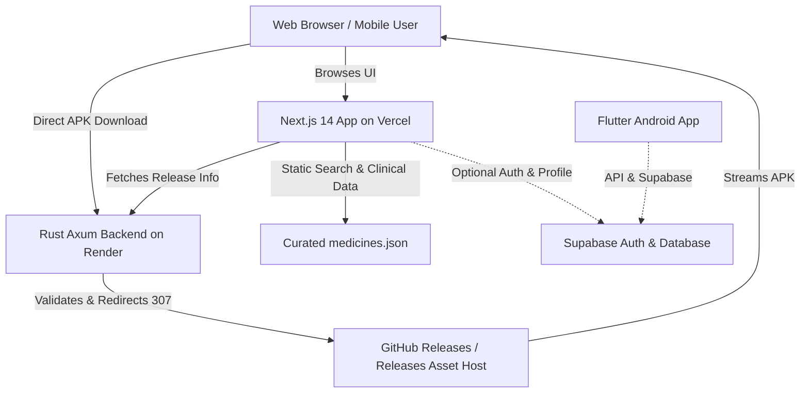

# Asrar-e-Tibb — Web Platform, Rust Backend & APK Distribution Architecture

## 1. Executive Summary

This document describes the modern web platform, high-performance Rust API backend, and automated Android APK release architecture built for **Asrar-e-Tibb**.

The modernization delivers:
1. A **Next.js 14 App Router** web application in `website/` styled with a custom design system adhering to the forest-green and warm-ivory palette.
2. A lightweight, memory-efficient **Rust Axum API** in `backend/api/` providing release metadata and secure APK download redirects.
3. An automated **GitHub Actions Release Pipeline** (`.github/workflows/android-release.yml`) for reproducible APK builds with SHA-256 cryptographic verification.
4. Complete preservation of existing Flutter mobile application code, Milestone 1 & 2 design tokens, Supabase security migrations, and staging test harnesses.

---

## 2. System Architecture



---

## 3. Website Architecture (`website/`)

### 3.1 Technology Stack & Aesthetics
- **Framework**: Next.js 14 (App Router) with TypeScript.
- **Styling**: Vanilla CSS design tokens (`src/app/globals.css`) for high rendering performance, zero runtime overhead, and exact control.
- **Color Palette**:
  - Forest Green: `#064E3B` (Primary Brand & Dark Surface)
  - Evergreen: `#0B6B4B` (Interactive Elements & Accent)
  - Fresh Green: `#23845B` (Highlights & Success States)
  - Warm Ivory: `#F7F7F2` (Background Canvas)
  - Pure White: `#FFFFFF` (Card Surfaces & Badges)
  - Deep Ink: `#12231D` (High-Contrast Typography)
  - Soft Sage: `#E6F0EA` (Borders & Subtle Fills)
  - Restrained Amber: `#E6B84B` (Badges & Warnings)

### 3.2 Page Catalog
| Route | Type | Description |
|---|---|---|
| `/` | SSR / Static | Hero, dynamic medicine search, category shortcuts, features, app download CTA |
| `/medicines` | Static / Client | Full medicine catalog with search, dosage form filters, pagination |
| `/medicines/[slug]` | SSG | Clinical medicine profile (brand, generic, manufacturer, indications, dosage form) |
| `/farmacia` | Client | Digital pharmacy storefront with interactive cart drawer and prescription notice |
| `/news` | Static | TibbNews health and wellness editorial feed with reading times |
| `/download` | SSR / Client | Dedicated Android APK download hub with version metadata, checksum, copy button, and install instructions |
| `/prescription-upload`| Static | Truthful "Coming Soon" page explaining the upcoming AI Prescription OCR pipeline |
| `/consultations` | Static | Truthful "Coming Soon" page for upcoming Telehealth Consultations |
| `/login` | Client | Authentication page with role whitelist notice (rejects admin self-assignment) |
| `/signup` | Client | Patient and healthcare professional registration page |
| `/about` | Static | Asrar-e-Tibb vision, medical mission, and platform scope |
| `/contact` | Client | Support channels, emergency advice, and interactive query form |
| `/privacy` | Static | Data privacy policy and medical confidentiality standards |
| `/terms` | Static | Terms of service, patient responsibility, and disclaimer |

### 3.3 Medicine Dataset & Image Badge Pipeline
- Extracted 2,939 authentic medicine records across 112 dosage forms from `medicine.csv` and `generic.csv` into `website/src/data/medicines.json` (1.39 MB).
- **`MedicineImageBadge`**: Reusable component rendering dosage-form-specific SVG iconography (tablets, syrups, injections, capsules, inhalers, drops, ointments). It avoids associating random images with medicines and prevents using developer portraits as medicine photos.

---

## 4. Rust Backend Architecture (`backend/api/`)

### 4.1 Framework & Middleware
- **Rust Stable** with **Axum 0.7** and **Tokio 1.39** async runtime.
- **Tower-HTTP**:
  - Structured request logging with request IDs.
  - Safe, configurable CORS (`CorsLayer`).
  - Strict request timeout (`TimeoutLayer`, 30s).
- **Graceful Shutdown**: Listens for `SIGINT` (Ctrl+C) and `SIGTERM`.

### 4.2 API Endpoints
#### `GET /healthz`
Lightweight HTTP 200 health check endpoint used by Render and container orchestrators.
```json
{
  "status": "ok",
  "version": "1.0.0",
  "service": "asrar-e-tibb-api",
  "timestamp": "2026-10-21T13:00:00Z"
}
```

#### `GET /api/v1/app/android/latest`
Returns typed release metadata:
```json
{
  "is_available": true,
  "version": "1.0.0",
  "release_date": "2026-10-21",
  "apk_filename": "Asrar-E-Tibb.apk",
  "download_url": "https://github.com/altafur-fuad/Asrar-E-Tibb/releases/latest/download/Asrar-E-Tibb.apk",
  "sha256_checksum": "e3b0c44298fc1c149afbf4c8996fb92427ae41e4649b934ca495991b7852b855",
  "file_size_bytes": null,
  "release_notes": "Official release of Asrar-e-Tibb Android Application with modernized navigation and security fixes."
}
```

#### `GET /api/v1/app/android/download`
Performs a safe HTTP 307 temporary redirect to the official release asset:
- **Open-Redirect Protection**: Strictly validates that the target URL scheme is `https` and the host matches an allowed host list (`github.com`, `objects.githubusercontent.com`).
- Returns HTTP 503 Service Unavailable if no release is configured, preventing dead links or fake downloads.

### 4.3 Containerization
Multi-stage `Dockerfile`:
- **Builder Stage**: `rust:1.80-slim` builds an optimized release binary.
- **Runtime Stage**: `debian:bullseye-slim` with `ca-certificates` and an unprivileged `appuser` (UID 10001). Final container image size is minimal (~40 MB).

---

## 5. Android APK Release Architecture

### 5.1 GitHub Actions Workflow (`.github/workflows/android-release.yml`)
- Triggered automatically on git tags matching `v*.*.*` or manually via `workflow_dispatch`.
- Steps:
  1. Installs JDK 17 and Flutter 3.24.x stable.
  2. Runs `flutter pub get` and executes all unit/widget tests (`flutter test`).
  3. Builds production APK: `flutter build apk --release`.
  4. Renames artifact to standard release name: `Asrar-E-Tibb.apk`.
  5. Computes cryptographic checksum: `sha256sum Asrar-E-Tibb.apk > Asrar-E-Tibb.apk.sha256`.
  6. Publishes GitHub Release with both `Asrar-E-Tibb.apk` and `Asrar-E-Tibb.apk.sha256`.

### 5.2 Integrity & Security Guidance
Users are instructed to verify their APK checksum prior to sideloading:
```bash
sha256sum -c Asrar-E-Tibb.apk.sha256
```

---

## 6. How to Build, Test, and Run

### 6.1 Website (`website/`)
```bash
cd website
npm install
npm test          # Runs dataset and cart logic test suite (node --test)
npm run build     # Builds production Next.js bundle (116 static pages)
npm run start     # Starts local production server
```

### 6.2 Rust Backend (`backend/api/`)
```bash
cd backend/api
cargo check
cargo test        # Runs unit and integration tests
cargo run         # Starts server on http://localhost:8080
```

### 6.3 Flutter Android App
```bash
flutter pub get
flutter test      # Runs all 25 unit/widget tests
flutter build apk --release
```

---

## 7. Environment Variables Reference

### Website (`website/.env.example`)
| Variable | Required | Description |
|---|---|---|
| `NEXT_PUBLIC_APP_VERSION` | Yes | Website display version (e.g. `1.0.0`) |
| `NEXT_PUBLIC_API_BASE_URL` | Yes | Base URL of the Rust Axum API (e.g. `https://asrar-e-tibb-api.onrender.com`) |
| `NEXT_PUBLIC_APK_DOWNLOAD_URL` | No | Fallback direct APK download URL |
| `NEXT_PUBLIC_GITHUB_REPO_URL` | Yes | GitHub repository URL (`https://github.com/altafur-fuad/Asrar-E-Tibb`) |
| `NEXT_PUBLIC_SUPABASE_URL` | Optional | Supabase Project URL |
| `NEXT_PUBLIC_SUPABASE_ANON_KEY` | Optional | Supabase Anonymous Client Key |

### Rust Backend (`backend/api/.env.example`)
| Variable | Required | Default | Description |
|---|---|---|---|
| `PORT` | Yes | `8080` | Server listening port (Render sets automatically) |
| `HOST` | No | `0.0.0.0` | Server listening host |
| `APP_VERSION` | No | `1.0.0` | API version string |
| `APK_IS_AVAILABLE` | Yes | `true` | Release availability flag |
| `APK_VERSION` | Yes | `1.0.0` | Latest published APK version |
| `APK_RELEASE_DATE` | Yes | `2026-10-21` | Date of release |
| `APK_FILENAME` | Yes | `Asrar-E-Tibb.apk` | Downloaded filename |
| `APK_DOWNLOAD_URL` | Yes | GitHub Release URL | Official download URL |
| `APK_SHA256_CHECKSUM`| Yes | SHA-256 hash | Verification hash |
| `APK_RELEASE_NOTES` | No | Text | Release changelog |
| `CORS_ALLOWED_ORIGINS`| No | `*` | Comma-separated list of allowed origins |
| `RUST_LOG` | No | `info,asrar_e_tibb_api=debug` | Log verbosity |

---

## 8. Deployment Guides

### 8.1 Deploying Backend to Render
1. In Render Dashboard, click **New +** -> **Blueprint**.
2. Connect repository `https://github.com/altafur-fuad/Asrar-E-Tibb`.
3. Select `render.yaml` (configured with service `asrar-e-tibb-api`, Docker environment, and health check path `/healthz`).
4. Click **Apply Blueprint**.
5. Note the assigned URL: `https://asrar-e-tibb-api.onrender.com`.

### 8.2 Deploying Website to Vercel
1. In Vercel Dashboard, click **Add New...** -> **Project**.
2. Import repository `altafur-fuad/Asrar-E-Tibb`.
3. In **Root Directory**, click Edit and select `website`.
4. Framework Preset will automatically detect **Next.js**.
5. Under **Environment Variables**, add:
   - `NEXT_PUBLIC_API_BASE_URL`: `https://asrar-e-tibb-api.onrender.com`
   - `NEXT_PUBLIC_APP_VERSION`: `1.0.0`
   - `NEXT_PUBLIC_GITHUB_REPO_URL`: `https://github.com/altafur-fuad/Asrar-E-Tibb`
6. Click **Deploy**.
